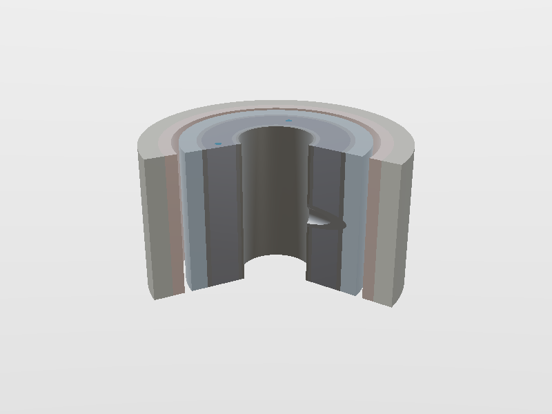
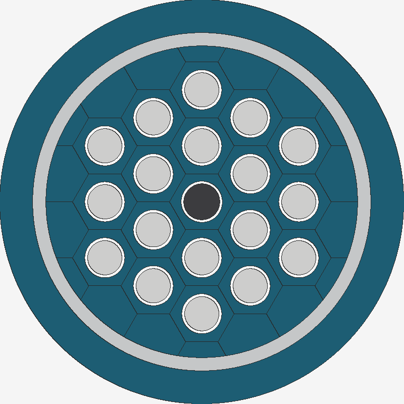

<p align="center">
  
</p>

<h1 align="center">llevantopen</h1>

<p align="center">
  <strong>Fast, exact geometry queries, 3D viewer, QA, and tally visualization for OpenMC XML and MCNP models</strong>
</p>

<p align="center">
  <a href="https://github.com/oursdesvosges/llevantopen/actions/workflows/ci.yml"></a>
  <a href="https://github.com/oursdesvosges/llevantopen/actions/workflows/openmc-integration.yml"></a>
  <a href="LICENSE"></a>
  <a href="https://github.com/Fusion4Energy/llevant"></a>
</p>

**llevantopen** extends [llevant](https://github.com/Fusion4Energy/llevant) with native pure-Rust **OpenMC XML** support (`llevant-openmc`, zero OpenMC runtime needed for geometry) and **OpenMC HDF5 statepoint tally loading** (`llevant.read_openmc_tally`), alongside full MCNP support (through [migjorn](https://crates.io/crates/migjorn)). From the interactive 3D viewer, the command line, Python, or Rust, it answers:

- **OpenMC XML & MCNP geometry**: load `model.xml`, `geometry.xml` (with auto-discovered sibling `materials.xml`), directories, in-memory XML via `from_text`, and MCNP inputs;
- **exact point & ray queries**: where points lie (`locate` / `classify`) and every segment a line crosses (`trace`) through nested universes, transforms, and rectilinear/hexagonal lattices;
- **2D slices & GPU 3D views**: interactive `llevant-viewer` and batch CPU/GPU renders with hiding, isolation, cutaways, and ghost shells;
- **QA & stochastic volumes**: gaps and overlaps (`check`) plus cell, material, and universe volumes with honest uncertainties;
- **fingerprints & diffs**: tell two revisions of a model apart cell by cell (`fingerprint --diff`);
- **OpenMC cell `name="..."` label queries**: select, isolate, hide, or bound cells by name (`label "Tungsten"`);
- **tally & field overlays**: OpenMC HDF5 statepoints (`read_openmc_tally`), MCNP `meshtal`, `MCTAL`, D1SUNED `cuvmsh`, and CSV drawn over the geometry.

| OpenMC fusion HTS blanket (3D cutaway) | OpenMC VVER hexagonal lattice (slice at `z=0`) |
|---|---|
|  |  |

Ready-to-run OpenMC models live in [`docs/examples/openmc`](docs/examples/openmc), alongside MCNP models in [`docs/examples`](docs/examples).


| Results over the geometry (mock pin powers) | A check finds the lid overlapping the cask |
|---|---|
|  |  |

## OpenMC support

`llevant-openmc` translates OpenMC XML models natively in pure Rust (no OpenMC runtime required to inspect, check, slice, render, or view geometry):

| Capability | Supported features |
|---|---|
| **Inputs** | `model.xml`, `geometry.xml` (auto-discovers sibling `materials.xml`), a directory containing either, and in-memory XML via `Model::from_text` / `llevant.from_text` |
| **Surfaces** | `x-plane`, `y-plane`, `z-plane`, `plane`, `sphere`, `x-cylinder`, `y-cylinder`, `z-cylinder`, `x-cone`, `y-cone`, `z-cone`, `x-torus`, `y-torus`, `z-torus`, and `quadric` |
| **Boundaries** | `vacuum`, `reflective`, `white`, and `periodic` outer boundary conditions |
| **Repeated structures** | Boolean CSG regions (`&`, `\|`, `~`, parentheses), nested `universe`/`fill`, `translation`, 3-angle Euler & 9-entry `rotation`, 2D/3D `<lattice>` and `<hex_lattice>` (`orientation="y"` & `"x"`, `<outer>`) |
| **Materials & labels** | Nuclide `ao`/`wo` and elemental compositions (`g/cm3`, `kg/m3`, `atom/b-cm`, `atom/cm3`, `sum`), plus cell `name="..."` attributes exposed to `label "..."` queries |
| **HDF5 tallies (Python)** | `llevant.read_openmc_tally` loads `cell`, `material`, and `mesh` (`RegularMesh`, `RectilinearMesh`, `CylindricalMesh`) filters, scores by name or index, and `error=True` relative errors (`pip install h5py`) |

Full MCNP & OpenMC compatibility details: [`docs/reference/supported-input.md`](docs/reference/supported-input.md).

## Install

Install the OpenMC-enabled fork from GitHub:

**Rust CLI & interactive viewer:**

```sh
cargo install --git https://github.com/oursdesvosges/llevantopen llevant-cli --features gpu,viewer
```

**Python module (with CLI and viewer included):**

```sh
git clone https://github.com/oursdesvosges/llevantopen.git
cd llevantopen/crates/llevant-py
pip install .            # builds the Rust extension (or: maturin develop --release)
pip install h5py         # optional: needed only for llevant.read_openmc_tally
```

**Prebuilt binaries & Python wheels:** download or trigger builds for Linux and Windows (`x86_64`) from the fork's [Release workflow](https://github.com/oursdesvosges/llevantopen/actions/workflows/release.yml).

> **Note:** Upstream PyPI (`pip install llevant`) and `Fusion4Energy/llevant` releases track upstream MCNP-only `llevant` and do not include `llevant-openmc` or `read_openmc_tally`.

## Try it (OpenMC & MCNP)

### OpenMC XML (CLI & Python)

Try the included OpenMC examples (`fusion_hts_blanket.xml`, `vver_hex_assembly.xml`, `pwr_pin_lattice.xml`):

```sh
llevant info   docs/examples/openmc/fusion_hts_blanket.xml
llevant locate docs/examples/openmc/fusion_hts_blanket.xml 0 62 0  0 95 0
llevant render docs/examples/openmc/fusion_hts_blanket.xml --wedge 0,0,0,0,0,1,-110,10 --colour realistic -o blanket.png
llevant slice  docs/examples/openmc/vver_hex_assembly.xml --plane z=0 --colour realistic -o vver.png
llevant check  docs/examples/openmc/pwr_pin_lattice.xml --h 0.75
llevant view   docs/examples/openmc/fusion_hts_blanket.xml
```

From Python (use `python -m llevant` for the CLI bundled in the wheel):

```python
import llevant

m = llevant.load("docs/examples/openmc/fusion_hts_blanket.xml")
m.locate(0, 62, 0)                      # <Label inside 2>
m.bbox('label "Tungsten"')              # searches OpenMC cell name="..."
m.check(12.0)                           # gaps and overlaps

# Overlay OpenMC HDF5 statepoint tallies on any slice or 3D render (requires h5py):
f = llevant.read_openmc_tally(m, "statepoint.100.h5", score="flux")
m.slice(z=0, field=f)
```

See [`docs/guide/python.md`](docs/guide/python.md) and [`docs/guide/cli.md`](docs/guide/cli.md) for the full API and CLI options.

### MCNP

[`docs/examples/cask.i`](docs/examples/cask.i) is a small MCNP cask model (fuel pins on a concrete floor):

```sh
llevant info   docs/examples/cask.i            # sizes, extent, diagnostics
llevant locate docs/examples/cask.i 0 0 100  80 0 100
llevant slice  docs/examples/cask.i --plane z=100 --colour material -o slice.png
llevant render docs/examples/cask.i --hide 5 --clip 0,0,0,0,-1,0 --colour realistic -o view.png
llevant check  docs/examples/cask.i --h 2      # exit status 1 if gaps or overlaps
llevant view   docs/examples/cask.i            # the viewer (or: llevant-viewer)
```

```python
import llevant

m = llevant.load("docs/examples/cask.i")  # compiled once, cached on disk
m.classify(points)                        # (N, 3) numpy array -> numpy columns
m.volumes(h=2).by("material")             # volumes with their uncertainty
```

## How fast

On a 425 k-cell fusion reactor model, on a 16-thread laptop ([`docs/benchmarks.md`](docs/benchmarks.md)):

| | |
|---|---|
| Load | 1.3 s from the cache (36 s to compile the first time) |
| Points | 5.4 million classified per second |
| Lines | 3.3·10⁵ lines of 100 cm traced per second |
| Slices | 110 ms for 1000 rows |
| Gaps and overlaps | the 36 × 37 × 35 m building checked on lines 5 cm apart in under 3 minutes |
| Viewer | 60 fps while orbiting (GPU) |

## What it does

| Query | Command | Library |
|---|---|---|
| Where points are: cell path, material, density; gaps, overlaps, on-surface | `locate` | `Model::classify` |
| What lines cross: exact segments, the surface at each end | `trace` (`--lines` for a file of them) | `Model::trace` |
| 2D slices with exact boundaries, cell and surface labels | `slice` | `Model::slice`, `llevant_render::labels` |
| 3D views: hidden cells, cutaways, universe levels, ghost shells | `render` (`--gpu`) | `Model::render`, `Model::first_hits`, `llevant-gpu` |
| Realistic images: materials sorted by composition, physically based shading | `render --colour realistic`, `materials` | `llevant_scene::materials`, `llevant_render::shading` |
| Volumes by cell, material, universe or tally bin, with an honest uncertainty | `volume` | `Model::volumes`, `volumes_to`, `instance_volumes` |
| Gaps and overlaps, with volume and location | `check` | `Volumes::problems` |
| Fingerprints of cells and universes; model diffs | `fingerprint` | `Model::fingerprints` |
| A universe (a filler) as a model of its own | `--universe` | `Model::universe` |
| Cell instances: each place a cell occupies, numbered | `locate` | `Model::instances` |
| Results over the geometry: OpenMC HDF5 statepoint, meshtal, MCTAL, D1SUNED cuvmsh, CSV | `slice`/`render --field`, `llevant.read_openmc_tally` | `llevant_scene::field` |
| An interactive viewer: 3D view and slice, picking, rules, cuts, fields, FMESH layout, card editing | `llevant-viewer`, `llevant view` | `crates/llevant-viewer` |
| Python: OpenMC/MCNP models in memory, numpy batch queries, inline images, the viewer | `python -m llevant` | `crates/llevant-py` |

What OpenMC XML and MCNP input is read, and what is not: [`docs/reference/supported-input.md`](docs/reference/supported-input.md).

## Library

```rust,no_run
use llevant::{Depth, Line, Model, Options, Status, DEFAULT_PRECISION};

fn main() -> Result<(), Box<dyn std::error::Error>> {
    // Loads OpenMC XML (`model.xml`, `geometry.xml` + `materials.xml`) or MCNP inputs identically.
    let model = Model::load("docs/examples/openmc/fusion_hts_blanket.xml", &Options::default(), None)?;
    let res = model.classify(&[[0.0, 0.0, 0.0], [0.0, 62.0, 0.0]], Depth::All);
    for &id in &res.ids {
        let label = &res.labels[id as usize];
        println!("{}", model.describe(label)); // e.g. "inside 12 > 304[1,-2,0] > 7"
        if label.status == Status::Inside {
            let cell = model.cell(label.cell().unwrap());
            println!("cell {} material {} density {}", cell.id, cell.material, cell.density);
        }
    }

    let line = Line::between([-250.0, 0.0, 0.0], [250.0, 0.0, 0.0]);
    let tr = model.trace(&[line], Depth::All)?;
    for k in tr.segments(0) {
        let out = model.surface_id(tr.surface_out[k]);
        let label = &tr.labels[tr.ids[k] as usize];
        println!("{} .. {}: {} -> {out:?}", tr.t0[k], tr.t1[k], model.describe(label));
    }

    let fp = model.fingerprints(DEFAULT_PRECISION)?;
    println!("{} cells fingerprinted", fp.cells.len());
    Ok(())
}
```

- **Batches.** Queries take batches and return flat arrays, ready for numpy: one label id per point or segment, with the labels interned.
- **Indices and numbers.** Labels refer to cells by index into `model.cells()`; `describe`, `cell_id`, and `surface_id` give cell/surface numbers.
- **Determinism.** Results are identical for any number of threads.
- **Errors.** Bad arguments are an `Error`, never a panic.

[`docs/contracts.md`](docs/contracts.md) lists what each query guarantees, and upstream Rust API docs are on [docs.rs](https://docs.rs/llevant).

## Layout

| Path | Purpose |
|---|---|
| `crates/llevant` | The engine (pure Rust, geometry only) |
| `crates/llevant-openmc` | Pure-Rust OpenMC XML translator (`model.xml`, `geometry.xml` + `materials.xml`) |
| `crates/llevant-scene` | What frontends build from a model: cell rules, hidden cells, material looks, field data and tally files, input cards, disk cache |
| `crates/llevant-render` | Images: colours, colour scales, field looks, physically based shading, labels, PNG |
| `crates/llevant-gpu` | The GPU renderer (`wgpu`) |
| `crates/llevant-viewer` | The `llevant-viewer` desktop app and its `egui` widgets |
| `crates/llevant-cli` | The `llevant` command |
| `crates/llevant-py` | The Python module `llevant` (PyO3, abi3 wheels, OpenMC HDF5 tally reader) |
| `tools/bench` | `llevant-bench`: benchmarks, brute-force checks, and GPU vs CPU comparisons |
| `tools/mcnp-oracle` | Checks `llevant` against MCNP itself |
| `tools/synthetic` | Generators of benchmark models |
| `docs/` | Documentation site sources: user guides, [architecture](docs/architecture.md), [contracts](docs/contracts.md), [decisions](docs/decisions/README.md), [benchmarks](docs/benchmarks.md), and [internals](docs/internals/engine.md) |

## Develop

[`docs/CONTRIBUTING.md`](docs/CONTRIBUTING.md) has the full setup, test rules, and oracle instructions.

```sh
cargo test --release                                 # unit, MCNP golden, property, OpenMC, and CLI tests
cargo test --release -p llevant-openmc               # OpenMC translator unit tests
cargo test --release -p llevant --test openmc        # OpenMC engine integration tests
cargo test --release -p llevant-gpu -p llevant-viewer # GPU renderer and viewer (skip without an adapter)
pytest crates/llevant-py/tests/test_openmc.py        # Python OpenMC oracle & HDF5 statepoint tally tests
cargo run --release -p llevant-bench                 # benchmarks and checks
```

Licence: [EUPL-1.2](LICENSE).
